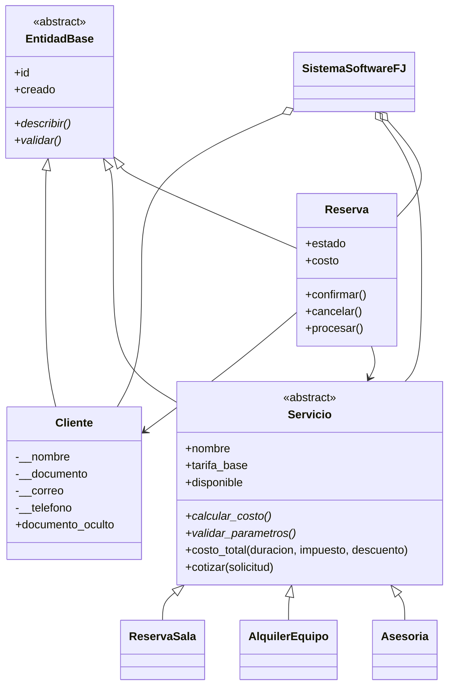

# Software FJ — Sistema Integral de Gestión de Clientes, Servicios y Reservas

Proyecto de la **Fase 4 — Componente práctico** del curso *Programación* (213023) de la
Universidad Nacional Abierta y a Distancia (UNAD). Es un sistema orientado a objetos en
Python, sin base de datos, que gestiona clientes, servicios y reservas de la empresa
ficticia **Software FJ**. Usa excepciones personalizadas y un archivo de logs para que
ningún error detenga la aplicación.

## Funcionalidades

- **Clientes** con datos encapsulados (atributos privados y propiedades con validación):
  nombre, documento (6 a 10 dígitos), correo y celular.
- **Servicios** a partir de una clase abstracta `Servicio`, con tres especializaciones:
  - `ReservaSala`: se cobra por hora, tiene capacidad máxima y suma un cargo de limpieza.
  - `AlquilerEquipo`: se cobra por día y por unidad, con 10 % de descuento desde 7 días.
  - `Asesoria`: se cobra por hora y el nivel del asesor (junior, senior o experto) cambia el precio.
- **Reservas** con estados `PENDIENTE → CONFIRMADA → PROCESADA` o `CANCELADA`.
- **Métodos sobrecargados**:
  - `costo_total(duracion, impuesto=None, descuento=None)` acepta parámetros opcionales.
  - `cotizar()` (`functools.singledispatchmethod`) se comporta distinto si recibe un número o un diccionario.
- **Manejo de excepciones**: jerarquía propia, `try/except`, `try/except/else`,
  `try/except/finally` y encadenamiento con `raise ... from`.
- **Logs** en `logs/software_fj.log` con fecha, nivel (INFO, ERROR, CRITICAL) y la causa de cada error encadenado.

## Estructura

```
software_fj/
├── main.py                  # simulación de 31 operaciones válidas e inválidas
├── software_fj/
│   ├── excepciones.py       # jerarquía de excepciones personalizadas
│   ├── registro.py          # configuración del archivo de logs
│   ├── entidad.py           # clase abstracta EntidadBase
│   ├── cliente.py           # clase Cliente (encapsulación y validaciones)
│   ├── servicios.py         # Servicio abstracto + ReservaSala, AlquilerEquipo, Asesoria
│   ├── reserva.py           # clase Reserva y enumeración EstadoReserva
│   └── sistema.py           # fachada SistemaSoftwareFJ (listas en memoria)
├── tests/test_software_fj.py
└── docs/                    # salida y log de una ejecución de ejemplo
```

## Diagrama de clases



## Excepciones personalizadas

| Excepción | Código | Cuándo se lanza |
|---|---|---|
| `SoftwareFJError` | FJ-000 | Base de todas las excepciones del sistema |
| `ValidacionError` | FJ-100 | Un dato no cumple las reglas de negocio |
| `ClienteInvalidoError` | FJ-101 | Nombre, documento, correo o teléfono incorrectos |
| `ParametroFaltanteError` | FJ-102 | Falta un dato obligatorio |
| `ServicioInvalidoError` | FJ-103 | Tarifa, duración, unidades o nivel fuera de rango |
| `ServicioNoDisponibleError` | FJ-200 | Se reserva un servicio en mantenimiento |
| `ReservaInvalidaError` | FJ-300 | La reserva no se puede confirmar (encadena la causa) |
| `OperacionNoPermitidaError` | FJ-400 | Acción inválida para el estado actual (p. ej. cancelar algo procesado) |
| `CalculoInconsistenteError` | FJ-500 | El costo da negativo (p. ej. un descuento del 150 %) |
| `RecursoNoEncontradoError` | FJ-600 | Cliente, servicio o reserva inexistente |

## Cómo ejecutarlo

Requiere Python 3.10 o superior y no usa librerías externas.

```bash
git clone https://github.com/keyceojeda10/software-fj-gestion.git
cd software-fj-gestion
python main.py              # corre la simulación y escribe logs/software_fj.log
python -m unittest -v       # corre las 18 pruebas unitarias
```

## Simulación

`main.py` ejecuta 31 operaciones: 17 terminan bien y 14 fallan a propósito. Entre las
que fallan hay un correo inválido, un documento repetido, una tarifa negativa, una
reserva de 15 horas, un servicio no disponible, un cliente inexistente, la cancelación
de una reserva ya procesada, un descuento del 150 %, una duración `"tres"` y un registro
corrupto que provoca un error inesperado. Todos los errores quedan en el log y el
programa llega hasta el resumen final sin detenerse.

Extracto de la salida (completa en [`docs/salida_ejemplo.txt`](docs/salida_ejemplo.txt)):

```
  ✘ [17] Confirmar reserva con duración inválida
        → [FJ-300] No se pudo confirmar la reserva RES-002 (La duración de 'Sala Innovación' debe estar entre 1 y 12 horas)
        ↳ causa: ServicioInvalidoError: [FJ-103] La duración de 'Sala Innovación' debe estar entre 1 y 12 horas (15)
```

Extracto del log (completo en [`docs/log_ejemplo.log`](docs/log_ejemplo.log)):

```
ERROR    | Operación 25 'Confirmar asesoría con duración no numérica' -> ReservaInvalidaError: ...
ERROR    |     causado por ServicioInvalidoError: [FJ-103] El campo 'duracion' debe ser numérico (tres)
ERROR    |     causado por ValueError: could not convert string to float: 'tres'
CRITICAL | Operación 31 'Importar cliente desde un registro con formato corrupto' (error inesperado) -> AttributeError: ...
```

## Flujo de trabajo en GitHub

El desarrollo se organizó por módulos. Cada módulo tuvo su *issue*, su rama `feature/...`
y un *pull request* que cierra el issue al fusionarse en `main`:

| Issue | Rama | Contenido |
|---|---|---|
| #1 | `feature/excepciones-y-logs` | Excepciones personalizadas y archivo de logs |
| #2 | `feature/entidades-y-cliente` | Clase abstracta y cliente encapsulado |
| #3 | `feature/servicios` | Servicio abstracto, tres servicios y sobrecarga |
| #4 | `feature/reservas` | Reserva con confirmar, cancelar y procesar |
| #5 | `feature/sistema-y-simulacion` | Fachada del sistema y simulación de operaciones |
| #6 | `feature/pruebas-y-docs` | Pruebas unitarias, ejemplos y README |

## Autor

Carlos Andrés Castro Ojeda — Ingeniería de Sistemas, UNAD (curso 213023, 2026).

## Referencias

- Van Rossum, G., & Drake, F. L. (2024). *The Python tutorial: Errors and exceptions*. Python Software Foundation. https://docs.python.org/3/tutorial/errors.html
- Python Software Foundation. (2024). *logging — Logging facility for Python*. https://docs.python.org/3/library/logging.html
